I build agent workflows that turn a brief into something you can run, inspect, and revise.

## Selected work

- **[BoHack · 讲界视频工坊](https://github.com/akechi0819-lgtm/knowledge-video-requirements)** · Founder & developer. An AI workbench that takes knowledge videos from brief to blueprint to rendered video. [Workbench redesign](https://github.com/akechi0819-lgtm/knowledge-video-requirements/pull/10) · [Worker orchestration](https://github.com/akechi0819-lgtm/knowledge-video-requirements/pull/11)
- **[AgentMind](https://github.com/realcarsonterry/AgentMind)** · Async Python framework for coordinating agents, with Ollama for local inference and LiteLLM for hosted models.
- **[AG2](https://github.com/ag2ai/ag2/pull/2548)** · Merged change that made disk caching optional and switched the default to in-memory caching.

**Research interests** · LLM infrastructure · Embodied AI · Mechanistic interpretability

## GitHub activity

<picture>
  <source media="(max-width: 600px)" srcset="assets/activity-compact.svg">
  
</picture>

> Build it. Trace how it works.
